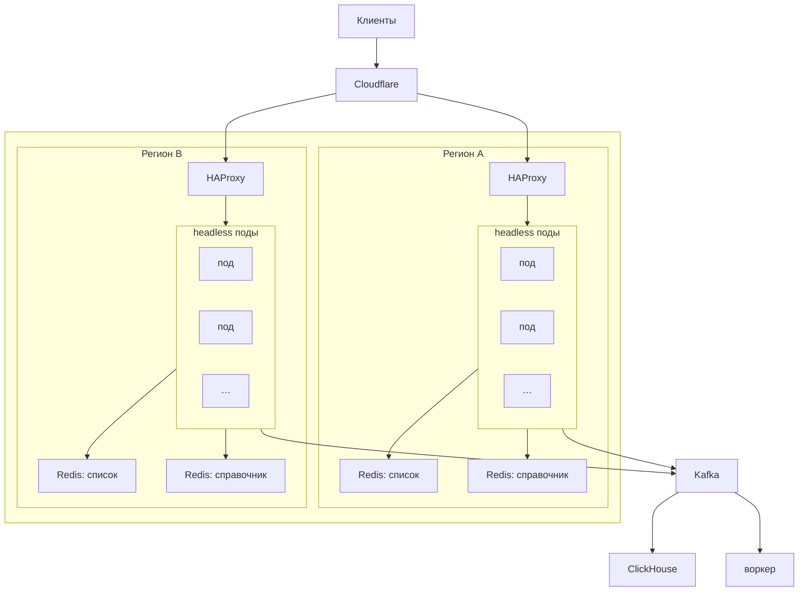

# georedirect

Отпечаток на быстром редиректе, до HTTP-ответа. Около 100 тысяч кликов в секунду. Клик короткий: TLS, проверки, событие в Kafka, ответ, закрытие.

## Путь

Регион принимает свою долю и трафик ещё одного региона.

Cloudflare отдаёт TCP. TLS заканчивается в поде, без sidecar. Иначе отпечатка ClientHello нет. HAProxy не разбирает TLS и шлёт Proxy Protocol v2. Иначе адрес клиента — это адрес прокси. Адреса подов HAProxy берёт из DNS headless Service и не перезагружается, когда число подов меняется.

`/healthz` перезапускает контейнер. `/readyz` убирает под из DNS. Число подов растёт по новым соединениям, не по процессору. Минимум подов больше нуля: холодный старт на клике недопустим.

## Кто что делает

Приложение на клике снимает отпечаток, проверяет чёрный список и рейт-лимит, пишет событие в Kafka и отвечает. Разбора потока оно не ждёт.

Воркер — другое приложение. Он читает клики из Kafka пачками, находит частые адреса и подсети и дописывает их в Redis чёрного списка. Следующий клик с такого адреса отклоняет под. Запись из Kafka в ClickHouse тоже не в этом процессе.

## До ответа

Отпечаток снимается в ClientHello, до HTTP. Дальше сверка с User-Agent, чёрный список и рейт-лимит. Попадание — отказ. Событие в Kafka пишется в любом случае, ответ его не ждёт.

В бойлерплейте отпечаток уже снимается. Сверка с User-Agent, чтение чёрного списка и проверка рейт-лимита ещё не включены: клик проходит. Справочник в память пода тоже ещё не читается.

Redis чёрного списка недоступен — клик проходит. Иначе падение Redis останавливает редирект. Событие всё равно пишется.

На клике нет похода в PostgreSQL. Оффер и правила читаются из памяти пода.

## Поставка

Образ катится по подам. Под, который не проходит `/readyz`, уходит из DNS. Новые клики идут на живые поды. Старый под перестаёт принимать новое, дописывает Kafka и закрывает Redis.

Адрес оффера, Redis и Kafka меняются по `SIGHUP`, приём не останавливается. Если файл конфига не разбирается, остаётся прежний снимок. Сертификат подхватывается на следующем рукопожатии, поды не перезапускаются. `listen_addr`, Proxy Protocol и таймауты сокета меняются только с новым процессом.

Откат — предыдущий образ.

## Стоимость владения

В счёте региона: минимум подов, два Redis, Kafka, ClickHouse и трафик Cloudflare. Клик не хранит состояние, поэтому смена региона — это второй контур на время сверки задержки, а не перенос базы.

ClickHouse не стоит на пути клика. Свой кластер обходится дисками и дежурством. ClickHouse Cloud снимает дежурство и добавляет плату за чтение и исходящий трафик. Пока антифрод и отчёты читают один кластер, свой дешевле.

В публичном облаке здесь платят за трафик, не за виртуальные машины. On-premise имеет смысл, когда плата за трафик превышает стоимость людей и железа. Sidecar на клике нет: лишний прокси добавляет задержку редиректа.

## Конфиг

Параметр лежит либо в env, либо в yaml.

| Env | |
| --- | --- |
| `CONFIG` | Путь к yaml. Пусто — `deployments/local.yaml` |
| `TLS_CERT` | Файл сертификата |
| `TLS_KEY` | Файл ключа |

Оба пути TLS вместе. Пустые оба — без TLS, отпечатка нет.

Yaml: `deployments/local.yaml`, `deployments/prod.yaml`.

| Поле | Когда |
| --- | --- |
| `listen_addr`, `proxy_protocol` | Старт |
| `read_timeout`, `write_timeout`, `shutdown_timeout` | Старт |
| `redis_addr` | Чёрный список и рейт-лимиты. `SIGHUP` |
| `reference_redis_addr` | Справочник. `SIGHUP` |
| `kafka_addr`, `kafka_topic` | `SIGHUP` |
| `offer_url` | `SIGHUP`. Уже начатый запрос ещё идёт на старый адрес |
| `redis_timeout` | `SIGHUP`, на новых соединениях |
